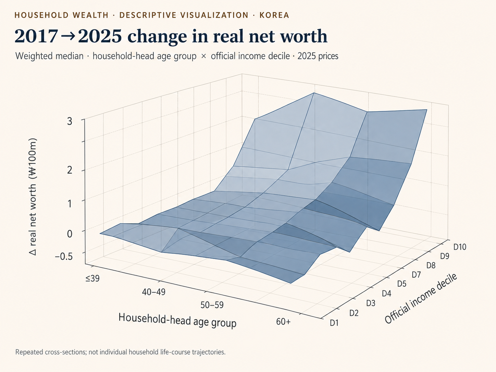

# Current Work

Research on institutions, governance, work, technological change, and how responsibility, risks, resources, and opportunities are distributed across people, households, organizations, and public systems.

This page is a first-meeting view of work that is moving now. It is selective rather than exhaustive: each item points to a live research question, its current stage, and where collaboration could be useful.

<strong>IIAS Conference 2026 · Seoul.</strong> I am presenting <em>From Training to First Credibility: Public Governance of Reciprocal Labour-Market Legibility</em>, a collaborative-governance design for the credibility gap facing people without established work histories when polished output becomes cheap. <a href="/records/IIAS_2026_Accepted_Contribution_Record_JooyeolKim.pdf">IIAS public record →</a> <a href="#first-credibility">Current project ↓</a>

## Governance & institutional systems

  

    

      From Training to First Credibility
      Who validates a new worker when polished output becomes cheap?
    

    

      Public governance · labour-market entry · credibility · public employment services
      
This project examines the credibility bottleneck facing people without established work histories and asks how public employment services might govern expert review without creating purchasable endorsement or one-sided candidate transparency. The design separates capability evidence, first credibility, employer-side job definition, and later job-specific verification rather than collapsing them into a single score.

      
<strong>Current stage:</strong> IIAS Conference 2026 presentation; collaborative-governance design using cross-national institutional sequence mapping across training, capability evidence, credibility formation, employer verification, and selection.

      
<strong>Collaboration:</strong> public employment services, recruitment, labour-market entry, skills signalling, early careers, credentialing, AI-assisted work, collaborative governance.

      
<a href="/records/IIAS_2026_Accepted_Contribution_Record_JooyeolKim.pdf">View IIAS public record →</a>

    

  

  

    

      Feasible-Set Governance (FSG)
      Before people choose, who structured the set of options they were allowed to see?
    

    

      Governance · choice environments · contestability · institutional design
      
FSG shifts analysis one step upstream from bounded choice. It asks who sets the feasible set, whose goals are embedded in it, whether affected actors can recognize that structuring, whether consent and exit are substantively meaningful, and whether the structure can be contested or revised.

      
<strong>Current stage:</strong> draft-backed cross-domain framework with a public overview, six analytical axes, governance tests, and applications spanning platforms, AI-mediated decisions, recruitment, eligibility, labour-market narrowing, and authentication-bound access.

      
<strong>Collaboration:</strong> public governance, platform governance, AI-mediated decision systems, autonomy, consent, exit, contestability, eligibility infrastructures.

      
<a href="/frameworks/feasible-set-governance.html">View framework overview →</a>

    

  

  

    

      Response Collapse &amp; Relational Reformatting
      What fails when institutions can recognize a claim but cannot answer, repair, or own the failure?
    

    

      Administrative burden · response · responsibility · institutional interaction
      
The Response Collapse Framework distinguishes visibility and recognition from accountable response, responsibility, repair, and returnable failure. A related relational-reformatting paper asks how actors with disproportionate control over interaction formats can standardize or risk-manage relationships in ways that shift proof, coordination, waiting uncertainty, and responsibility burdens downward.

      
<strong>Current stage:</strong> active framework plus a public-facing conceptual working paper applying the mechanism across public complaint systems, recruitment and submission markets, employment relationships, and a limited agricultural bargaining vignette.

      
<strong>Collaboration:</strong> citizen–state encounters, administrative burden, organizational attention, institutional trust and repair, public-service response, platform governance.

    

  

  

    

      Temporal Diffusion of Responsibility
      Why can waiting become safer than deciding when accountability arrives later?
    

    

      Accountability · decision timing · blame avoidance · governance
      
This framework isolates a timing problem in collective decision-making: acting can create immediate and traceable evaluative exposure, while deferral can postpone, dilute, or relocate when responsibility becomes consequential. Under those conditions, non-movement can become locally rational even when formal responsibility has not disappeared.

      
<strong>Current stage:</strong> active diagnostic framework and Public Choice Society conference submission using structured illustrative comparisons to distinguish pathological deferral from legitimate sequencing.

      
<strong>Collaboration:</strong> public accountability, organizational decision-making, regulatory governance, blame avoidance, institutional temporality, ex ante judgment under uncertainty.

    

  

  

    

      Legitimacy, Claimability &amp; Pressure Routing (LCE-PR)
      What happens when an order's own language of legitimacy becomes a language of claim against it?
    

    

      Legitimacy · claims · institutional pressure · correction
      
LCE-PR examines how legitimacy language can become claimable. Rights, procedure, performance, transparency, fairness, or responsibility may stabilize an order while also supplying standards through which excluded or peripheral actors can name a gap between promised standards and actual enjoyment.

      
The framework then asks how grievance becomes an addressable claim and how institutions route pressure: storage when meaningful response fails, containment when response does not contact the underlying lag, or correction when the response reaches the mechanism and produces a verifiable effect.

      
<strong>Current stage:</strong> working-note framework seed developed through scholarly discussion following the MCCT Hegemonies stream; public-facing diagnostic structure and correction test are in place.

      
<strong>Collaboration:</strong> legitimacy, public claims, institutional responsiveness, grievance translation, contestability, social movements, governance repair.

    

  

  

    

      CPRA: Grievance, Pressure &amp; Correction
      Where does grievance go after it becomes pressure?
    

    

      Pressure trajectories · contestability · collective response · institutional correction
      
CPRA is a pressure-trajectory framework for tracing how material and symbolic-existential grievances become individual responses, how those responses aggregate into collective pressure, how pressure is translated and routed, and whether the resulting response corrects the mechanism that produced the grievance.

      
Its upper layers distinguish pressure fates such as managed dissipation, blame concentration, paper victory, corrective consolidation, and system-level challenge. The central distinction is between the existence of pressure and the production of substantive correction.

      
<strong>Current stage:</strong> vNext integration architecture; the MCCT 2026 <em>Managed Dissipation</em> and <em>Managed Hegemony</em> presentations function as narrower conference-facing derivatives of the larger pressure and contestability architecture.

      
<strong>Collaboration:</strong> grievance formation, contestability, collective action, pressure routing, institutional response, substantive correction, democratic and organizational governance.

      
<a href="/records/MCCT_2026_Participation_Record_JooyeolKim.pdf">View MCCT participation record →</a> <a href="/records/MCCT_2026_Stream6_Managed_Hegemony_Accepted_Presentation_Record_JooyeolKim.pdf">Managed Hegemony record →</a>

    

  

## Work, households & political economy

Recent visual analysis

  

    

      Seeing the Wealth Surface
      Where did Korea's age × income-position wealth surface rise between 2017 and 2025?
    

    

      Household wealth · descriptive visualization · Korea
      

      
This descriptive research note places household-head age group, official income decile, and real net worth on a fixed grid so that changes in the shape of the wealth surface can be seen directly over time. It does not propose a new inequality index or causal model.

      
<strong>Current finding:</strong> the 2017–2025 change is not evenly distributed across the surface. The largest weighted-median increases are concentrated around the upper-income ridge, especially D10.

      
<strong>Current stage:</strong> short descriptive / visualization note using Korea's Household Finance and Welfare Survey, 2017–2025; level surfaces, repeated time deformation, and 2017–2025 delta surfaces are complete.

      
<strong>Interpretive caution:</strong> repeated cross-sections; the surface deformation should not be read as the life-course trajectory of the same households.

      
<strong>Collaboration:</strong> household wealth inequality, descriptive distribution analysis, visualization, age–income structure.

    

  

  

    

      Labour Persistence–Time Absorption (LPTA)
      When technology saves workers time, who gets that time?
    

    

      Working time · productivity · industrial relations
      
LPTA examines why productivity gains can reduce task-time without reducing working time. In time-based employment, saved task-time may reappear as denser workloads, task expansion, higher performance baselines, or intensified monitoring rather than reduced hours or recovery.

      
<strong>Current stage:</strong> ILERA Asia 2026 conference paper linking the mechanism to demographic ageing and unequal dependence on labour income.

      
<strong>Collaboration:</strong> working-time institutions, ageing labour markets, collective bargaining, productivity sharing, performance measurement.

      
<a href="/records/ILERA_Asia_2026_Accepted_Oral_Presentation_Record_JooyeolKim.pdf">View ILERA public record →</a>

    

  

  

    

      Japan–Korea Labour Retention &amp; Worker Option Architecture
      What turns staying, leaving, or continued employment into a particular worker trajectory?
    

    

      Japan–Korea comparison · worker voice · later-life employment · survey architecture
      
This ongoing comparative extension examines how workers' effective options are translated into employment outcomes. Existing Japanese and Korean surveys already capture exit intentions, constrained non-exit, retirement preferences, institutional gates, consultation, and employer-side HR practices in considerable detail. The remaining question is narrower: how a worker's concrete option or claim connects to an employer response, an actual workplace adjustment, and subsequent stay, exit, or continued employment.

      
<strong>Current stage:</strong> preliminary Japan–Korea survey-architecture audit; identifying what can already be recovered from existing microdata before proposing additional measurement.

      
<strong>Collaboration:</strong> later-life employment, worker voice, internal labour markets, HRM, longitudinal surveys, Japan–Korea comparison.

    

  

  

    

      Labour-Income Sufficiency Coverage (LISC) / SEHRR
      Is labour income actually enough to sustain a household?
    

    

      Wages · household reproduction · social protection
      
This line separates labour-market income sufficiency from household total-resource adequacy and asks how far earnings actually cover selected living or household-reproduction requirements.

      
<strong>Current stage:</strong> a Korea–UK–US portability pilot for LISC is closed; current work is moving toward literature positioning, benchmark comparability, decomposition, and links to household-level sufficiency analysis.

      
<strong>Collaboration:</strong> living wages, income adequacy, household reproduction, in-work insufficiency, comparative labour-market data, social protection.

    

  

  

    

      Work Decomposition &amp; Human Asset Reclassification
      How AI reshapes tasks, skills, and worker value.
    

    

      AI · tasks · skills · workforce transition
      
This research maps how task bundles loosen and recombine as codification and coordination costs change, and how new task architectures can reprice workers' existing skill bundles. The question is not only whether a worker is more or less skilled, but how convertible existing capabilities are into the newly required bundle.

      
<strong>Current stage:</strong> synthesis map linking task architecture, re-embedding of tacit skill, worker repricing, organizational restructuring, and the LPTA time-allocation problem.

      
<strong>Collaboration:</strong> AI and work, occupational change, retraining, internal labour markets, skill transfer, organizational design.

    

  

  

    

      Attribution Political Economy
      Who gets the performance — and who carries the risk?
    

    

      Contribution · compensation · risk · responsibility
      
This research separates the aggregation of distributed contributions from the later attribution of benefits, costs, risks, and responsibility. It examines how organizational performance can consolidate many small contributions while responsibility and adjustment costs remain distributed elsewhere.

      
<strong>Current stage:</strong> active conceptual architecture spanning performance attribution, risk attribution, gate structures, and organizational responsibility unbundling.

      
<strong>Collaboration:</strong> compensation systems, labour process, organizational performance, HR systems, risk allocation, worker contribution.

    

  

## Also exploring

  

    

      Local Food Choice-Set Dynamics (LFCS)
      How might household purchasing capacity and small-business turnover reshape everyday local choice?
    

    

      Household demand · self-employment · local economies
      
LFCS distinguishes store counts from the consumer-facing set of choices actually available in a neighbourhood. A high-context pilot in Banghwa 3-dong, Seoul reconstructed longitudinal choice sets, business lifecycles, same-site replacement, and spatial sensitivity; the descriptive and audit layer is closed, while post-pilot mechanism work and comparative expansion remain open.

      
<strong>Collaboration:</strong> disposable income, household demand, self-employment, local service economies, business turnover, neighbourhood change.

    

  

## Selected writing

These shorter public pieces show how the same questions are applied to live governance, AI, labour, and policy problems.

  <a class="feature selected-writing-link" href="/briefs/governance/2026-06-26-ib-public-contract-geneva.html">
    
Governance · public contracts

    
<h3>Who Really Controls South Korea's Public School Reform?</h3>
A governance reading of public spending, certification authority, legal jurisdiction, exit conditions, and what remains in public hands after institutional localization.
Read →

  </a>
  <a class="feature selected-writing-link" href="/briefs/ai-governance/delegation-without-responsibility.html">
    
AI governance · responsibility

    
<h3>Delegation Without Responsibility</h3>
Why ambient and wearable AI turns the question from output quality toward delegated authority, visible control, and responsibility for action.
Read →

  </a>
  <a class="feature selected-writing-link" href="/briefs/labour/2026-06-11-performance-attribution-symmetry.html">
    
Labour · attribution

    
<h3>Performance Attribution Symmetry</h3>
A compact argument for applying the same attribution logic to gains and losses instead of individualizing failure while collectivizing success.
Read →

  </a>
  <a class="feature selected-writing-link" href="/briefs/policy/yellow-envelope-act-procedural-risk.html">
    
Policy · labour law

    
<h3>Yellow Envelope Act: Early Procedural Risk</h3>
An early-stage procedural reading of uncertainty, responsibility, and implementation risk around labour-law change.
Read →

  </a>

  <a class="button secondary" href="/analysis/">More issues &amp; analysis</a>
  <a class="button secondary" href="/selected-work.html">Selected work</a>

## Other work

My broader research also covers AI governance, platform visibility, diagnostic protocols, political communication, research integrity, and knowledge-production systems.

  
<h3><a href="/ideas/">Ideas &amp; Frameworks</a></h3>
Reusable concepts and analytical architectures.

  
<h3><a href="/diagnostics/">Diagnostic Work</a></h3>
Protocols, audits, and applied review formats.

  
<h3><a href="/essays/">Essays &amp; Papers</a></h3>
Longer public arguments and venue-shaped outputs.

  
<h3><a href="/cv.html">Public Record</a></h3>
Accepted work, current status, public identifiers, and record files.

## Work with me

I am especially interested in conversations where another dataset, country case, institutional setting, or disciplinary lens could test, extend, or challenge one of these structures.

  <a class="button primary" href="/work-with-me.html">Work With Me</a>
  <a class="button secondary" href="mailto:jooyeol@jooyeolkim.com">Email me</a>
  <a class="button secondary" href="/cv.html">Public Record</a>

